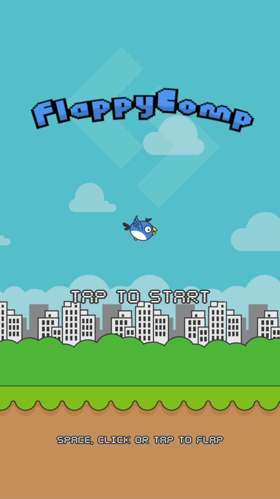
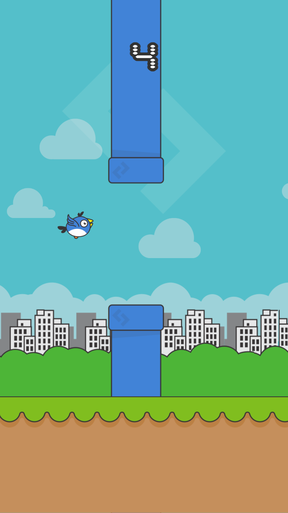

# FlappyComp

FlappyComp is a Flappy Bird style game that runs in the browser. It uses plain HTML5 Canvas and JavaScript. It has no framework, no dependencies, and no build step.

[Play FlappyComp in your browser](https://rahelmartim.github.io/flappy-comp/)

<p align="center">
  
  
</p>

## How to play

Fly the bird through the gaps between the pipes. You get one point for each pipe that you pass. If the bird hits a pipe, the ground, or the top of the screen, the game ends.

| Action | Keyboard | Mouse or touch |
| --- | --- | --- |
| Flap, start, restart | `Space`, `Up arrow`, `W`, or `Enter` | Click or tap |
| Pause or continue | `P` or `Esc` | Tap while paused |
| Sound on or off | `M` | Speaker button |

The game saves your best score and your sound setting in the browser local storage.

## Run it locally

The game loads its files with ES modules and `fetch`, so you must serve the folder over HTTP. If you open `index.html` directly from disk, the game does not load.

1. Clone the repository.
2. Start a static server in the project folder.
3. Open <http://localhost:8000> in your browser.

```sh
git clone https://github.com/rahelmartim/flappy-comp.git
cd flappy-comp
python3 -m http.server 8000
```

Any static server works. For example, you can use `npx serve` instead of Python.

## Project structure

```text
index.html        Page that holds the canvas and the sound button
style.css         Page layout and the font declaration
src/
  main.js         Startup, input, screen scaling, and the game loop
  game.js         Game states, physics, pipes, collisions, and drawing
  audio.js        Sound effects (Web Audio) and music (<audio> elements)
  assets.js       Asset paths and image loading
  config.js       Game constants, for example gravity, speed, and pipe gap
assets/
  images/         Sprites and backgrounds
  audio/          Music and sound effects
  fonts/          BYTE pixel font
docs/             Screenshots for this README
```

The game draws in a fixed space of 360 by 640 logical pixels. `main.js` scales that space to fit the window and the device pixel ratio. Physics runs at a fixed step of 1/120 second, so the game feels the same at any refresh rate.

To change the difficulty, edit `src/config.js`. For example, `PIPES.gap` sets the gap size and `WORLD.speed` sets the scroll speed.

## Debug mode

If you add `?debug` to the URL, the page exposes the game object as `window.game`. You can then read the game state from the browser console, for example `game.score` or `game.bird`.

## Deploy

The site is static, so GitHub Pages serves it directly from the root of the `master` branch. The empty `.nojekyll` file tells GitHub Pages to serve the files as they are.

## History

The first version of FlappyComp was a Unity project. This version is a rewrite for the web. It keeps the original sprites, music, sound effects, and font.
